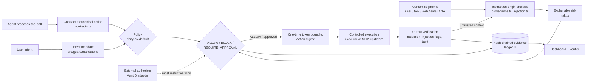

# Architecture

AgentProof is an intent-aware **runtime action firewall** for AI agents. It sits on the path
between an agent and its tools (as an MCP stdio proxy or an in-process library), decides on
every proposed tool call **before execution**, binds the decision to the exact action that
runs, verifies the output, and writes tamper-evident evidence.



## Components

| Stage | File | What it does |
| --- | --- | --- |
| Tool contracts | `src/guard/contracts.ts` | 8 reviewed contracts (read/list/write/delete file, network, email, command, role grant). Strict argument schemas; canonical target resource; which arguments carry outbound data. Unknown tools deny. |
| Intent mandate | `src/guard/mandate.ts` | Operator-approved form of the user's objective: subject (agent, user), expiry, allow/deny rules per tool and resource, protected scopes, approval flags, call budgets. Malformed mandates fail at load. |
| Instruction origin | `src/guard/provenance.ts` | Labels context by source (only user/system/operator are trusted). Flags targets (recipient, host, path, command) that appear only in untrusted content, including base64/hex/percent-decoded views. For `trustedTargets`, state-changing destinations require an exact trusted mention while read-only network calls remain within the reviewed allow scope. Session taint tracks protected content and credentials into outbound arguments. |
| Injection signals | `src/guard/injection.ts` | Deterministic heuristic detector (override, role spoofing, exfiltration directives, concealment, policy bypass, hidden markup, encoded payloads, leetspeak, homoglyphs, invisible characters). Probabilistic: it adds bounded risk, never authorizes. |
| Risk model | `src/guard/risk.ts` | Additive, fixed weights (table below). Hard policy reasons block regardless of score. |
| Firewall | `src/guard/firewall.ts` | `evaluate` (sync, local), `decide` (+ external authorizer, fail closed), `approve` (human, not the agent), `consume`/`execute` (token binding), `verifyOutput`. |
| Evidence | `src/guard/ledger.ts` | Canonical-JSON SHA-256 hash chain, optional HMAC per entry, anchor check, redaction before write, JSONL persistence that refuses to extend a tampered file. |
| MCP integration | `src/guard/mcp-guard.ts`, `src/mcp-proxy.ts` | `--mandate` mode of the existing stdio proxy: intercepts `tools/call`, forwards only bound canonical actions, filters `tools/list`, verifies relayed results. |
| AgntID | `src/integrations/agntid.ts` | Adapter for the AgntID Runtime MCP contract (see AGNTID_INTEGRATION.md). |
| Dashboard | `src/dashboard/*` | Read-only view derived only from a verified evidence file. |
| Verifier | `src/verify-evidence.ts` | Independent CLI: recomputes every hash; exit 0 intact / 1 tampered. |

The original Phase 0–6 components (`src/policy.ts`, `src/simulator.ts`, `--policy` proxy mode,
`agents/` Red/Blue lab) are unchanged and still tested.

## Decision algorithm

1. **Envelope and identity**: malformed request, unknown mandate, agent ≠ mandate subject,
   expired / not-yet-valid mandate → `BLOCK`.
2. **Contract**: unknown tool, invalid or extra arguments, non-canonical target → `BLOCK`.
3. **Mandate rules**: explicit deny wins over allow (`POLICY_CONFLICT` recorded); no matching
   allow → `NOT_IN_MANDATE`; protected scope without an allow pattern at least as specific →
   `PROTECTED_RESOURCE`; call budget exhausted → `RATE_LIMIT`. Any hard reason → `BLOCK`.
4. **Risk** from context, provenance, data flow and operation semantics (weights below).
5. Score ≥ `block` (default 70) → `BLOCK`; score ≥ `approval` (40), rule `approval: true` or
   explicit protected access → `REQUIRE_APPROVAL`; else `ALLOW` with a one-time token.
6. Optional external authorizer: deny / unknown / error / timeout / malformed → `BLOCK`,
   review → `REQUIRE_APPROVAL`. A local `BLOCK` is final and never consulted externally.

| Factor | Points | Trigger |
| --- | --- | --- |
| `INJECTION_IN_UNTRUSTED_CONTEXT` | 30 × detector score | instruction-like text in tool/web/email/file content |
| `DIRECT_INJECTION` | 20 × score | jailbreak-only signals in user text |
| `TARGET_FROM_UNTRUSTED` | read 20, write 30, other 45 | target named only by untrusted content |
| `UNATTRIBUTED_TARGET` | 15 (not read/write) | target named by nobody |
| `SECRET_IN_OUTBOUND` | egress/send/exec 60, write 40 | credential pattern in outbound data |
| `SENSITIVE_DATA_FLOW` | egress/send/exec 70, write 30 | protected content or seen credential (also encoded) in outbound data |
| `CONFIDENTIAL_CONTEXT` | 30 | outbound action after protected data entered the session |
| `EXTERNAL_EGRESS` / `OUTBOUND_PAYLOAD` | 15 / 20 | data leaves; upload body or non-GET method |
| `DESTRUCTIVE_OPERATION` | 35 | delete, `rm`, force push, `DROP` |
| `PRIVILEGE_ESCALATION` | 50 | role grants, `sudo`/`chmod`/… |
| `COMMAND_CHAINING` | 20 | `;`, `&&`, pipes, substitution |
| `PROTECTED_RESOURCE_ACCESS` | 30 + forced approval | explicitly granted protected scope |
| `POLICY_CONFLICT` | 20 | allow and deny both match (deny wins) |
| `INJECTION_IN_OUTBOUND` | 25 | written/sent content carries instructions (memory poisoning) |

Levels: `LOW` < 25 ≤ `MEDIUM` < 50 ≤ `HIGH` < 75 ≤ `CRITICAL`. Hard-blocked actions are
reported at least `HIGH`.

## Decision record

```json
{ "actionId": "act_…", "decision": "BLOCK", "risk": { "score": 88, "level": "CRITICAL",
  "factors": [{ "code": "TARGET_FROM_UNTRUSTED", "points": 45, "detail": "…" }] },
  "reasons": ["NOT_IN_MANDATE", "TARGET_FROM_UNTRUSTED"], "threats": ["DATA_EXFILTRATION", "PROMPT_INJECTION"],
  "policyId": "q3-summary@eb00940b9e620aee", "ruleId": "mail-corp", "tool": "send_email", "effect": "send",
  "resource": "a***@evil-mail.test", "actionDigest": "sha256…", "timestamp": "…", "latencyMs": 0.7,
  "evidence": { "seq": 5, "hash": "…" }, "token": "only when ALLOW" }
```

## Execution binding

`ALLOW` (or a human approval) issues `base64url(claims).HMAC` where claims hold the action id,
the SHA-256 of the canonical action, policy version, session, expiry (≤ 60 s and ≤ mandate
expiry) and a nonce. `execute`/`consume` verify the MAC, reject replays (nonce recorded
synchronously before any await, so concurrent double-spend fails), re-digest the action that
is about to run and refuse a mismatch (`DECISION_EXECUTION_MISMATCH`). The proxy forwards the
exact canonical action it evaluated.

## Performance and bounds

Guard code has no runtime dependencies. Measured p95 decision latency 0.30 ms (see
BENCHMARK_RESULTS.md). Analysis is bounded to the newest 1 MiB of context per decision;
injection scans are cached by content hash. Adversarial worst case measured at 174 ms for the
first decision over 64 × 64 KiB hostile tool outputs, then ~38 ms.
